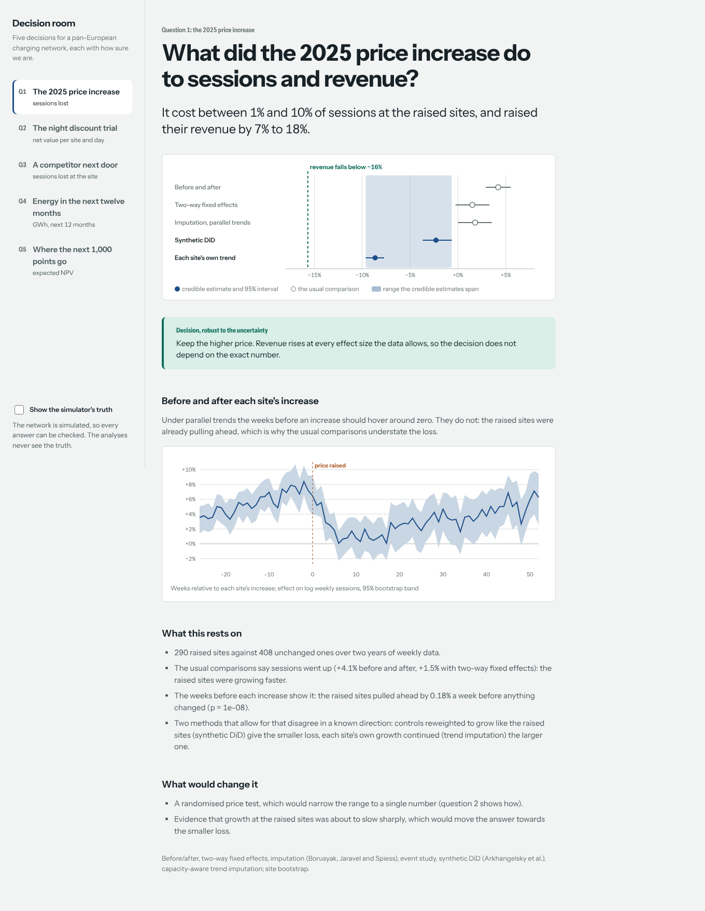

# charge-network-decision-lab

Five decisions a charging-network operator has to make, answered the way a data scientist should
answer them for a CEO: an estimate, a range that admits what the data cannot tell apart, and a
statement of whether the decision survives that range.

The network is simulated: 1,200 fast-charging sites in eleven European countries, daily from
January 2023 to September 2026, with saturation at busy sites, competitors opening next door,
outages, a staggered 2025 price increase and a 2026 night-discount trial. Because the world is
simulated, every answer is graded against the truth, on the development world and on twelve
held-out worlds written by someone who never read the analyses.



## The five questions

| | Question | Methods | Development world, against the truth |
|---|---|---|---|
| 1 | Did the 2025 price increase of €0.10/kWh pay? | before/after, two-way fixed effects (pyfixest), imputation (Borusyak–Jaravel–Spiess), event study, synthetic DiD, capacity-aware trend imputation, bootstrap | True effect on sessions −7.9%. The usual estimates say +1.5% (TWFE) and +4.1% (before/after); four of five intervals miss. The reported range covers the truth, and keeping the price was the right call. |
| 2 | Should the night discount go network-wide? | switchback trial on 80 sites, CUPED power analysis, fixed effects with carryover, randomisation inference, always-valid sequential test (mSPRT) | Revenue effect −€143 per site and day against a true −€118, inside the interval. True net value −€136 a site-day: "do not roll out" was right. |
| 3 | What does a competitor opening next door cost? | synthetic control with placebo inference; imputation pooled over 131 openings | One site: −16% against a true −20%. Network: −14.4% against a true −14.1%; both inside the intervals. |
| 4 | How much energy will the network sell next year? | seasonal naive, AutoETS (statsforecast), global LightGBM (mlforecast), capacity-aware site model; chosen by backtest; conformal intervals | 3.7% mean monthly error by country over the true future (backtest: 4.2% against 5.9% for AutoETS). Country intervals cover 61% of country-months against 80% nominal: too narrow. The network total's band covers 10 of 11 months. |
| 5 | Where should the next 1,000 high-power points go? | hierarchical Bayesian demand model (NumPyro, NUTS), 200 posterior scenarios, mixed-integer programme with CVaR (HiGHS), cannibalisation, grid and country constraints | The plan earns 82% of what a planner who knew true demand would earn; choosing by traffic earns 58%. Its own expected NPV (€519m) is optimistic against the true €394m. |

Numbers are from `reports/latest.json`, written by `cndl run`.

## Held-out worlds

Twelve worlds in `heldout/worlds-2026-10`, written blind from `heldout/WRITING_WORLDS.md` by an
agent that never read the analyses: price increases targeted the other way or at random, saturated
networks, short and noisy trials, competition waves, slow and fast markets, dense cannibalisation.
They were run once; `reports/heldout/worlds-2026-10/first_run.json` is that run and is not rewritten.

| | Held-out result (12 worlds) |
|---|---|
| Release gate | **4 of 12 passed.** |
| Price increase | The decision (keep the price) was right in 12 of 12. The reported range covered the true effect in only **6 of 12**; two-way fixed effects covered it in 1 of 12. |
| Night discount | Revenue effect covered and decision right in 12 of 12. |
| Competitor | Network-wide interval covered the truth in **6 of 12**: the intervals are too narrow. |
| Forecast | Median monthly error by country 3.9% (2.6% to 8.3%). 80% intervals covered a median 72% of country-months: too narrow. |
| Rollout | Median 80% of the oracle's NPV (53% to 85%); better than choosing by traffic (25% to 55%) in 12 of 12. |

What this says: the decisions held up; the ranges did not. Half the time the true price and
competitor effects fell outside the intervals, which is exactly what a CEO brief must not
pretend away. One gate failure is a gate design issue rather than an analysis error: the
"usual estimate must miss" check belongs to the development world, and in `random-increase`
the usual estimate was right, as it should be. The analyses were not changed after this run;
improving them now would need a new blind set.

## Why the usual answer is wrong here

The price increase went first to sites whose local demand was already growing (the operator
raised prices where it could). Comparing raised and not-yet-raised sites therefore credits the
price with growth that was coming anyway, and busy sites hit their capacity, which bends any
trend that is fitted on the log scale. The trap is part of the gate: if the usual estimate ever
stops missing on the development world, the test proves nothing and the gate fails.
`docs/adr/0002` explains why the brief reports a range instead of picking a winner.

## Run it

```bash
uv sync
uv run pytest -q          # unit, property and isolation tests, seconds
uv run cndl run           # world, warehouse, five analyses, briefs, evaluation, release gate (~6 min)
uv run cndl heldout worlds-2026-10   # the held-out set; resumable, one world at a time

uv run cndl export-web
cd web && npm ci && npm run build && npx vite preview   # the decision room on :4180
npm test && npx playwright test
```

## Layout

```
config/world.yaml       the simulator's true parameters (only the simulator and evaluation read it)
config/analysis.yaml    what an analyst would know: costs, capacity per point, method settings
config/contracts.yaml   data contracts for every raw table and mart
config/release.yaml     the release gate
src/cndl/sim/           the structural simulator
sql/                    DuckDB staging and marts
src/cndl/analysis/      price_change, offpeak_trial, competitor, forecast, site_model, rollout
src/cndl/briefs.py      one-page CEO briefs, every number from a result file
src/cndl/evaluation.py  grades every answer against the truth, including an oracle rollout
web/                    the decision room: React 19, Vite, TypeScript, motion, d3
heldout/                blind worlds and the guide they were written from
```

## Limits

- The data is simulated. The results show that the methods recover a known truth under the
  conditions built into the simulator; they say nothing about any real network.
- The simulator and the analyses were written by the same author. The held-out worlds reduce,
  but do not remove, the risk that the analyses fit the simulator's quirks.
- Forecast intervals by country are too narrow, and the rollout's expected NPV is optimistic;
  both are reported as they came out.
- After the held-out first run, two forecast bugs found on the development world were fixed
  (the network total's interval and a row-order dependence). The first run is kept as it was.
